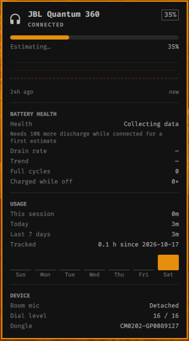

# JBL Quantum for Omarchy

Battery, battery-health history and usage stats for the **JBL Quantum 360 Wireless** headset in the [Omarchy](https://omarchy.org) bar — read straight from its 2.4 GHz USB dongle. No QuantumENGINE, no Windows, no root daemon.

<p align="center">
  
</p>

## Features

- **Battery in the bar**: `󰋋 35%`, dimmed when the headset is off, highlighted when low
- **Time remaining** estimated from your own recent drain rate
- **24 h battery chart**, with gaps where the headset was off
- **Battery health**: measured hours per full charge compared to JBL's rated 22 h, plus a trend against your first estimate, so you can watch the cell age over months
- **Equivalent full cycles** and how many times it was charged
- **Usage stats**: current session, today, last 7 days (bar chart) and total tracked hours
- **Notifications** at 20 % and 10 %, and when it reaches 100 %
- **Boom-mic attached / detached** status
- **One click (or middle-click on the icon) to make the headset your default audio output and mic**

All history stays local, in `~/.local/share/jbl-quantum/history.db` (SQLite).

## Requirements

- Omarchy with the Quickshell bar (plugins in `~/.config/omarchy/plugins`)
- JBL Quantum 360 Wireless with its USB dongle (`0ecb:2115`). Check it with `lsusb | grep 0ecb`
- `python3`, `pactl` and `notify-send`. All three ship with Omarchy.

## Install

```bash
omarchy plugin add https://github.com/Cluxnei/omarchy-jbl-quantum.git --enable
~/.config/omarchy/plugins/cluxnei.jbl-quantum/install.sh
```

`install.sh` does two things a shell plugin can't do on its own:

1. **udev rule** (asks for `sudo` once): `/etc/udev/rules.d/70-jbl-quantum.rules` gives the logged-in user (`uaccess`) access to the dongle's HID node. Nothing else gets access.
2. **User service** `jbl-quantum.service`: a small Python daemon (standard library only) that listens to the dongle and keeps the history.

The widget shows up on the right side of the bar. Move it with `omarchy plugin enable cluxnei.jbl-quantum --section left|center|right`.

### Uninstall

```bash
~/.config/omarchy/plugins/cluxnei.jbl-quantum/install.sh --uninstall
omarchy plugin remove cluxnei.jbl-quantum
rm -rf ~/.local/share/jbl-quantum   # only if you want to drop the history too
```

## Usage

| Action | What it does |
|---|---|
| Click | Open / close the popup |
| Middle-click | Set the headset as default output and mic |
| `o` in the popup | Same as middle-click |
| `Esc` | Close |

The bar widget has three settings (Omarchy's bar settings or `~/.config/omarchy/shell.json`): `showPercent`, `hideWhenAbsent` and `lowLevel`.

The daemon reads `~/.config/jbl-quantum/config.json`, if it exists:

```json
{
  "ratedHours": 22,
  "notifyLevels": [20, 10],
  "notifyFull": true,
  "pauseMediaOnDisconnect": false,
  "sampleSec": 60
}
```

`pauseMediaOnDisconnect` needs `playerctl`. Restart the service after changing the file: `systemctl --user restart jbl-quantum`.

## How battery health is measured

The headset doesn't report its own health, so it is estimated from history:

1. While the headset is connected, the daemon stores one battery sample per minute.
2. It looks at stretches where the battery only goes down (not charging) and adds up **% lost ÷ hours connected** over the last 30 days. That gives the drain rate.
3. **Hours per charge = 100 ÷ drain rate.** Health is that number compared to the rated 22 h. One estimate is stored per day, so *Trend* compares today with your very first estimate.

The first number appears after about 10 % of discharge. It gets steadier over a week or two of normal use. Volume and mic use affect drain too, so read it as a trend, not a lab measurement.

Charging isn't reported by the dongle either. The daemon infers it from the battery going up while connected. If the headset was charged while off, the daemon notices the jump on the next connect and counts it as a charge.

## Protocol notes

The dongle exposes a vendor-defined HID interface (`/dev/hidrawN`, interface 5). These are the values found by reverse engineering, each one byte. The dongle pushes the input report on every change, and the matching feature report can be polled:

| Input | Feature | Meaning |
|---|---|---|
| `0x08` | `0x49` | Battery % |
| `0x09` | `0x68` | Headset link (1 = connected) |
| `0x06` | `0x67` | Boom mic attached |
| `0x10` | `0x62` | 0–16, follows the headset dial |
| `0x03` | | Unknown, always 0 so far (logged) |
| | `0x61` | Chip ID + serial (ASCII) |

Unknown input reports are saved to the `events` table as `in_XX`, so new behaviour can be spotted in the history.

### Other Quantum models

Other JBL Quantum wireless headsets probably speak something similar. If you have one, these scripts make it quick to map:

```bash
python3 tools/probe.py /dev/hidrawN        # dump every feature report
python3 tools/watch.py /dev/hidrawN 120    # print changes while you power-cycle, plug the mic, etc.
```

(Find the right `hidrawN` with `grep -l 0ECB /sys/class/hidraw/*/device/uevent`. You'll need the udev rule with your product ID first.) Please open an issue or PR with what you find.

## Troubleshooting

- **Popup says "Start the daemon"**: run `systemctl --user status jbl-quantum` and `journalctl --user -u jbl-quantum`.
- **"Dongle not plugged in" while it is plugged in**: check that the udev rule applied with `getfacl /dev/hidraw*` (your user should be listed). Replugging the dongle also helps.
- **Widget changes don't show up after editing `Model.js`**: QML caches JS libraries. Run `omarchy-restart-shell`.

## License

MIT
